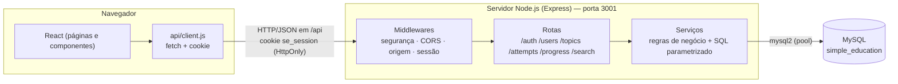
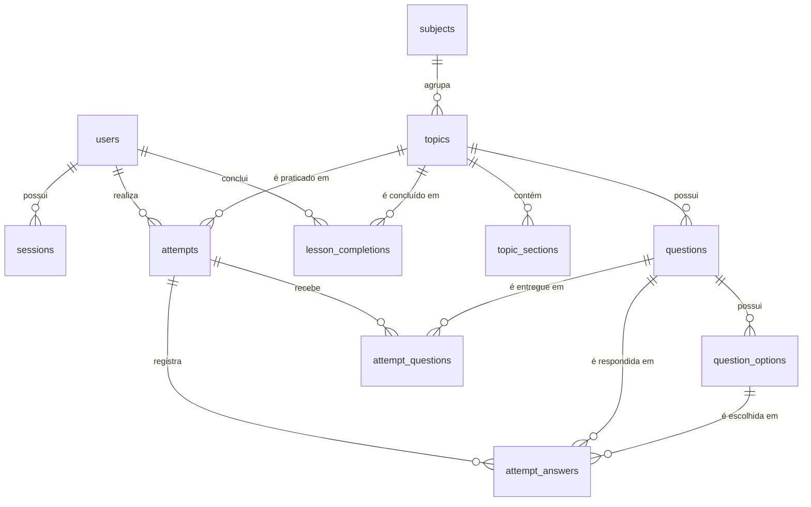
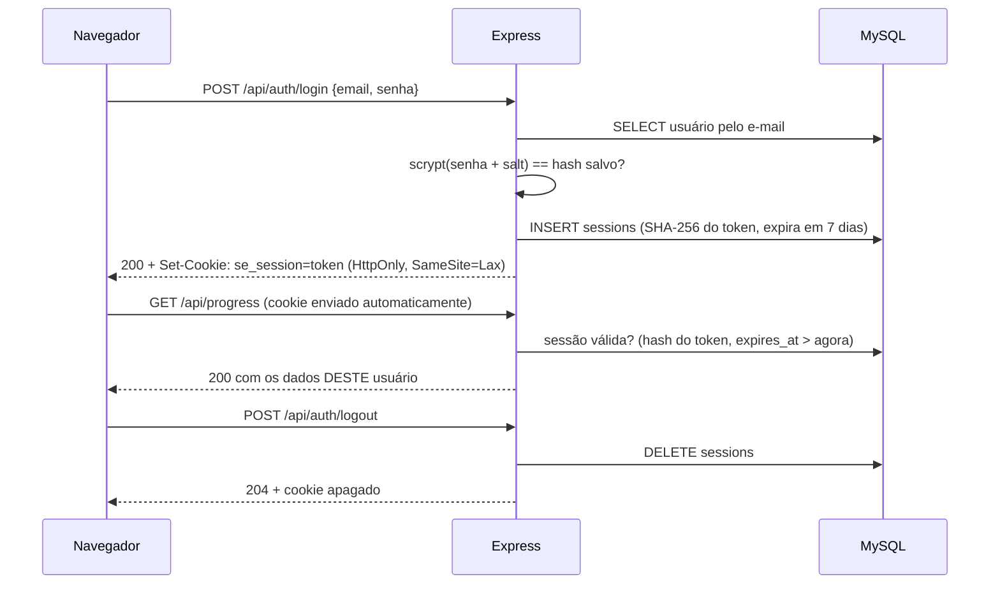

# Documentação técnica — Simple Education

Sumário:
1. Estrutura de pastas
2. Arquitetura
3. Banco de dados
4. API
5. Autenticação
6. Regras de correção e progresso
7. Testes e resultados reais
8. Segurança
9. Publicação online (pendente)

---

## 1. Estrutura de pastas

```
simple-education/
├── package.json              Scripts da raiz (npm workspaces: backend + frontend)
├── package-lock.json         Versões exatas de todas as dependências
├── README.md
├── scripts/
│   ├── iniciar.mjs           npm run iniciar: cria o .env, confere tudo, gera o build e inicia o servidor
│   └── verificar.mjs         npm run verificar: confere Node, dependências, .env, MySQL (conexão, senha, versão) e porta
├── docs/                     Documentação (este arquivo, API, banco, roteiro, defesa, validação)
│
├── backend/                  API REST — Node.js + Express + MySQL
│   ├── .env.example          Modelo de configuração (sem segredos)
│   ├── package.json
│   ├── src/
│   │   ├── server.js         Ponto de entrada: migrations + carga + inicia o Express
│   │   ├── app.js            Monta o Express: segurança, CORS, sessão, rotas, erros, site compilado
│   │   ├── config.js         Lê o backend/.env
│   │   ├── db/
│   │   │   ├── connection.js       Pool MySQL e funções all/get/value/run/transaction
│   │   │   ├── migrate.js          Aplica migrations pendentes (tabela schema_migrations)
│   │   │   ├── migrations/         001_init, 002_lesson_completions, 003_conteudo_pedagogico
│   │   │   ├── seed/index.js       Carga sincronizável do conteúdo
│   │   │   ├── seed/content/       ano1.js, ano2.js, ano3.js — as 9 aulas e 45 questões
│   │   │   ├── seed/export.js      Gera docs/conteudo-pedagogico.md
│   │   │   ├── diagnostics.js      Traduz erros do MySQL em mensagens com solução; confere a versão do MySQL/MariaDB
│   │   │   ├── check.js            Confere a integridade do conteúdo no banco
│   │   │   └── reset.js            Apaga e recria o banco (desenvolvimento/apresentação)
│   │   ├── middlewares/      auth (sessão), originCheck (CSRF), loginLimiter, requestLogger, errorHandler
│   │   ├── routes/           auth.js, users.js, content.js, attempts.js
│   │   ├── services/         Regras de negócio e SQL: user, session, content, attempt, progress
│   │   └── utils/            validate, password (scrypt), normalize (busca), params, httpError
│   └── tests/                Testes de integração (node:test + supertest) e conferência matemática
│
└── frontend/                 Interface — React + Vite
    ├── index.html
    ├── vite.config.js        Proxy /api → http://localhost:3001
    ├── .env.example          VITE_API_URL (padrão /api)
    └── src/
        ├── main.jsx          Ponto de entrada (fontes e estilos)
        ├── App.jsx           Mapa de rotas (públicas e privadas)
        ├── api/client.js     ÚNICO lugar com chamadas HTTP
        ├── context/AuthContext.jsx   Usuário logado (consultado no servidor)
        ├── components/       AppLayout (menu + pesquisa), RouteGuards, LessonBody (fórmulas), ui, Icons
        ├── pages/            Login/Cadastro, Início, Conteúdos, Aula, Exercícios, Revisão, Progresso, Pesquisa, Configurações, 404
        ├── hooks/            useApi (carregando/erro/dados), usePageTitle
        ├── styles/           global.css (cores e componentes), pages.css
        └── utils/format.js   Datas, rótulos e opções de ano
```

## 2. Arquitetura

O sistema tem três camadas: o **navegador** (React), o **servidor** (Express) e o **banco** (MySQL). O navegador nunca acessa o banco diretamente.



Versão em texto:

```
[Navegador: React]  --HTTP/JSON /api + cookie-->  [Express: middlewares → rotas → serviços]  --SQL-->  [MySQL]
```

**Em desenvolvimento**, o Vite (5173) entrega o React e repassa `/api` para o Express (3001). **No modo apresentação**, o Express entrega o site compilado (`frontend/dist`) e a API no mesmo endereço (3001). Nos dois casos, site e API ficam na **mesma origem** para o navegador, então o cookie funciona sem configuração extra.

**Camadas do backend:**

| Camada | Responsabilidade | Exemplo |
|---|---|---|
| Middlewares | Rodam antes de toda rota: segurança, CORS, verificação de origem, leitura da sessão | `loadSession` coloca o usuário em `req.user` |
| Rotas | Recebem a requisição, validam parâmetros e chamam o serviço | `POST /attempts/:id/answers` |
| Serviços | Regras de negócio e SQL | `answerQuestion` corrige e grava a resposta |
| Banco | Guarda os dados com chaves estrangeiras e restrições | `attempt_answers` |

## 3. Banco de dados

MySQL 8 (testado também em MariaDB 10.11), InnoDB, `utf8mb4`, datas em UTC. Estrutura criada por 3 migrations versionadas. Detalhes de cada campo: [modelo-de-dados.md](modelo-de-dados.md).



| Relacionamento | Tipo | Observação |
|---|---|---|
| usuário → sessões, tentativas, aulas concluídas | 1:N | Apagar o usuário apaga tudo dele (CASCADE) |
| matéria → aulas → seções e questões | 1:N | Conteúdo da carga inicial |
| questão → alternativas | 1:4 | Exatamente 1 com `is_correct = 1` (conferido por `db:check`) |
| tentativa → questões entregues (`attempt_questions`) | N:N | Guarda quais questões o aluno recebeu, para o histórico não mudar se o conteúdo mudar |
| tentativa → respostas | 1:N | Única por (tentativa, questão): não dá para responder duas vezes |
| usuário × aula (`lesson_completions`) | N:N | Chave composta (usuário, aula) |

**Migrations e carga:** `npm run db:migrate` aplica as migrations ainda não registradas em `schema_migrations`. `npm run db:seed` sincroniza o conteúdo por **slug** (aulas) e **código** (questões, ex.: `funcoes-01`): rodar de novo não duplica nada; se uma questão já usada por alunos mudar, a versão antiga é arquivada (`active = 0`) para preservar o histórico.

## 4. API

Base `/api`, JSON, autenticação por cookie. Exemplos completos de requisição e resposta: [api.md](api.md).

| Método | Rota | Login | Função |
|---|---|---|---|
| GET | `/health` | — | Verifica se a API está no ar |
| GET | `/auth/session` | — | Sessão atual (`user` ou `null`), sempre 200 |
| POST | `/auth/register` | — | Cadastra e já inicia a sessão |
| POST | `/auth/login` | — | Entra (limite de 5 erros / 15 min) |
| POST | `/auth/logout` | — | Encerra a sessão no servidor |
| GET | `/auth/me` | ✔ | Usuário logado (401 sem sessão) |
| PATCH | `/users/me` | ✔ | Altera nome e/ou ano escolar |
| GET | `/subjects` | ✔ | Matérias (card Matemática) |
| GET | `/subjects/:slug` | ✔ | Aulas agrupadas por ano |
| GET | `/topics?year=&subject=` | ✔ | Lista aulas com filtros |
| GET | `/topics/:slug` | ✔ | Aula completa (sem questões e sem gabarito) |
| PUT / DELETE | `/topics/:slug/completion` | ✔ | Marca / desmarca aula concluída |
| GET | `/search?q=` | ✔ | Pesquisa (2 a 100 caracteres) |
| POST | `/topics/:slug/attempts` | ✔ | Inicia tentativa; devolve questões sem gabarito |
| POST | `/attempts/:id/answers` | ✔ | Envia `{questionId, optionId}`; devolve correção e explicação |
| POST | `/attempts/:id/finish` | ✔ | Finaliza e calcula a nota |
| GET | `/attempts/:id` | ✔ | Revisão (gabarito só das respondidas) |
| GET | `/attempts?topic=&limit=&offset=` | ✔ | Histórico paginado |
| GET | `/progress` | ✔ | Resumo geral, por ano e por aula |

Erros sempre no formato `{ "error": { "code", "message", "details"? } }` com status 400, 401, 403, 404, 409, 413, 429 ou 500.

## 5. Autenticação



| Elemento | Como funciona | Por quê |
|---|---|---|
| Senha | `scrypt` com salt aleatório de 16 bytes; comparação em tempo constante | Hash lento e com salt dificulta descobrir a senha mesmo com o banco vazado |
| Token | 32 bytes aleatórios; no banco fica só o SHA-256 | Quem lê o banco não consegue usar as sessões |
| Cookie | `HttpOnly`, `SameSite=Lax`, `Secure` em produção, 7 dias | JavaScript da página não lê o cookie; reduz roubo de sessão e CSRF |
| Expiração | `expires_at` conferido em toda requisição | Sessão velha deixa de valer |
| Logout | Apaga a sessão no banco | O cookie antigo para de funcionar imediatamente |
| Identidade | Sempre `req.user` (vindo da sessão), nunca um id enviado pelo navegador | Ninguém consegue se passar por outro aluno |
| Login errado | Mesma mensagem para e-mail inexistente e senha errada; limite de 5 erros em 15 min | Não revela quem tem conta; dificulta adivinhação |
| Frontend | Ao abrir, consulta `/api/auth/session`; nada fica em `localStorage` | O servidor é a única fonte da verdade |

## 6. Regras de correção e progresso

**Correção (sempre no servidor — `attemptService.js`):**

1. Ao iniciar, o servidor sorteia as questões ativas da aula, grava em `attempt_questions` e envia ao navegador **sem** a alternativa correta e **sem** explicação.
2. O navegador envia só `questionId` e `optionId`. O servidor confere se a tentativa é do aluno, se não foi finalizada, se a questão pertence à tentativa e se a alternativa pertence à questão.
3. O servidor compara com o gabarito do banco, grava a resposta e soma o acerto (na mesma transação) e só então devolve se acertou, a alternativa correta e a explicação.
4. Responder a mesma questão duas vezes é bloqueado (chave única no banco → 409).
5. Ao finalizar, a nota é `acertos ÷ total de questões` (não respondidas contam como erro). Campos como `isCorrect` ou `scorePercent` enviados pelo navegador são ignorados.

**Progresso (`progressService.js`):**

| Termo | Definição |
|---|---|
| Aula concluída | O aluno marcou "Marcar aula como concluída" (independe dos exercícios) |
| Exercício respondido | Existe resposta registrada para a questão em uma tentativa |
| Acerto | Resposta igual ao gabarito, conferida pelo servidor |
| Tentativa finalizada | Encerrada pelo aluno; só ela tem nota |
| Assunto dominado | Melhor nota entre as tentativas finalizadas ≥ **70%** |
| Situação da aula | `Não iniciado` (nada feito) · `Em andamento` (qualquer atividade) · `Concluído` (aula concluída **e** assunto dominado) |
| Taxa de acertos | Acertos ÷ exercícios respondidos |
| Continuar estudando | Aula em andamento com a atividade mais recente |

Refazer exercícios cria uma nova tentativa; as anteriores ficam no histórico. O limite de 70% é decisão do projeto (`MASTERY_THRESHOLD`).

## 7. Testes e resultados reais

Comando: `npm test` (backend; MySQL ligado). Usa o banco separado `simple_education_test`, recriado a cada execução.

| Arquivo | Qtde | O que verifica |
|---|---|---|
| `auth.test.js` | 13 | Health; cadastro (hash, cookie HttpOnly, validação por campo, ano opcional, e-mail repetido 409); `/me` e `/session`; login certo/errado; logout invalida; sessão vencida; limite 429; origem estranha 403; JSON malformado 400; rota inexistente 404 |
| `content.test.js` | 7 | Rotas exigem login; matérias; aulas por ano na ordem das telas; filtro por ano; aula sem gabarito; pesquisa (acentos, curingas, tamanho); marcar/desmarcar aula |
| `attempts.test.js` | 7 | Questões sem gabarito; correção e explicação só após responder; nota não aceita do navegador; resposta repetida 409; questão/alternativa de fora 400; finalizar idempotente; histórico preservado; isolamento entre alunos |
| `progress-and-profile.test.js` | 6 | Diferença entre aula concluída, respondido e acertado; melhor nota; isolamento do progresso; alterar nome/ano; recusa de campos proibidos; nenhuma resposta expõe senha, hash ou token |
| `security.test.js` | 6 | CORS só para origens configuradas; 403 para origem estranha; cookie `Secure` em produção; cabeçalhos de segurança e `no-store`; formato padrão de erro e 413; limite de login configurável |
| `database.test.js` | 9 | Migrations idempotentes; 9 aulas/45 questões/4 alternativas/1 correta; carga repetida não duplica e não apaga progresso; questão alterada e usada é arquivada; restrições e FKs ativas; acentos (utf8mb4) |
| `diagnostics.test.js` | 11 | Mensagens em português para MySQL desligado, senha recusada, sem permissão, endereço inválido, MySQL antigo, porta ocupada e erro desconhecido; dica de aspas para senha com `#`; versão mínima do MySQL (8.0.19) e do MariaDB (10.2, incluindo o formato do XAMPP `10.4.32-MariaDB`) |
| `content-math.test.js` | 51 | Recalcula em JavaScript a resposta de **cada uma das 45 questões** e compara com o gabarito; alternativas sem valores equivalentes; dificuldades e letras distribuídas; 32 resultados dos exemplos resolvidos |

**Resultados obtidos na validação da entrega (cópia limpa):** ver o resumo no final deste arquivo e em [relatorio-validacao.md](relatorio-validacao.md). Suíte atual (111 testes): todos aprovados em MySQL 8.0.46 e MariaDB 10.4.34 (série do XAMPP); a suíte de 100 testes também foi aprovada em MariaDB 10.11.14.

**Validação ponta a ponta (Playwright):** 18 fluxos + 7 verificações extras com navegador real, backend real e MySQL — todas aprovadas em 3 execuções seguidas. Script: `docs/validacao/validate.cjs` (específico do ambiente de validação, mantido como registro).

## 8. Segurança (resumo)

- SQL sempre parametrizado (`?` + valores separados) — sem concatenação de dados do usuário.
- Validação de todas as entradas no servidor (o frontend também valida, mas só para ajudar o usuário).
- Verificação do cabeçalho `Origin` em POST/PUT/PATCH/DELETE + cookie `SameSite=Lax` contra requisições forjadas.
- CORS apenas para as origens do `.env`.
- Cabeçalhos `X-Content-Type-Options`, `X-Frame-Options`, `Referrer-Policy`; respostas da API com `Cache-Control: no-store`.
- Logs com método, rota, status e tempo — sem corpo, cookies ou senhas.
- Textos do conteúdo exibidos como texto pelo React (sem HTML cru), evitando injeção de código.

## 9. Publicação online (pendente)

O projeto **não foi publicado** nesta etapa. Se a avaliação exigir um link online, será preciso:

| Item | Configuração |
|---|---|
| Hospedagem Node.js | Serviço que rode `npm install`, `npm run build` e `npm start` (Node 22) |
| MySQL acessível pelo servidor | Banco gerenciado ou na mesma máquina; preencher `DB_HOST`, `DB_PORT`, `DB_USER`, `DB_PASSWORD`, `DB_NAME` como variáveis de ambiente (nunca no código) |
| HTTPS | Obrigatório; usar `NODE_ENV=production` e `COOKIE_SECURE=true` |
| Proxy reverso | Se o serviço usar proxy (a maioria usa), `TRUST_PROXY=true` para o limite de login identificar o IP real |
| Origem | Mantendo site e API no mesmo endereço (como no modo apresentação), CORS não precisa de ajuste; se separar, incluir o endereço do site em `CORS_ORIGINS` |
| Primeira carga | O servidor aplica migrations e conteúdo ao iniciar; conferir com `npm run db:check` |
| Usuário do banco | Com permissão de criar tabelas; em produção, não usar `db:reset` |

---

## Resultado da validação da entrega (17/11/2026)

O ZIP da entrega foi descompactado em uma pasta nova e instalado **somente com as instruções do README**, usando bancos separados (`se_entrega` e `se_entrega_test`) para não tocar no ambiente original.

| Etapa | Comando | Resultado |
|---|---|---|
| Instalação | `npm install` | ✅ Concluída, 0 vulnerabilidades |
| Configuração | cópia de `backend/.env.example` → `backend/.env` | ✅ Só usuário, senha e nomes dos bancos alterados |
| Banco | `npm run setup` | ✅ 3 migrations; 9 aulas, 27 exemplos, 45 questões (18 fáceis, 18 médias, 9 difíceis); `db:check` OK |
| Testes | `npm test` | ✅ **100 testes, 100 aprovados, 0 falhas** |
| Build | `npm run build` | ✅ Sem erros nem avisos |
| Modo apresentação | `npm run apresentacao` | ✅ Site, rotas internas e `/api/health` respondendo na porta 3001 |
| Modo desenvolvimento | `npm run dev` | ✅ Site na 5173, proxy `/api` e API na 3001 |
| Ponta a ponta | `docs/validacao/validate.cjs` (Playwright, navegador real) | ✅ **22 de 22 verificações aprovadas** (18 fluxos + links, gabarito, console/rede, API indisponível) |
| Instalação guiada (Windows 11) | `npm run iniciar` sem `backend/.env` e sem build | ✅ `.env` criado, conferência toda ✔, build gerado, site e login na porta 3001 — com MySQL 8.0.46 e com MariaDB 10.4.34 |
| Mensagens de erro (Windows 11) | `npm run verificar` | ✅ Explicação e solução para: sem `npm install`, sem `.env`, MySQL desligado, senha recusada, porta 3001 ocupada |
| Testes (Windows 11) | `npm test` | ✅ **111 testes, 111 aprovados** no MySQL 8.0.46 e no MariaDB 10.4.34 |

Ambiente: Linux, Node 22.23.4, npm 10.9.9, MySQL 8.0.46, Chromium (Playwright 1.63.0); linhas "Windows 11": Node 22.19.0, npm 10.9.3, MySQL e MariaDB em Docker. Não executado: o XAMPP Control Panel em si, outros navegadores, celular físico.
