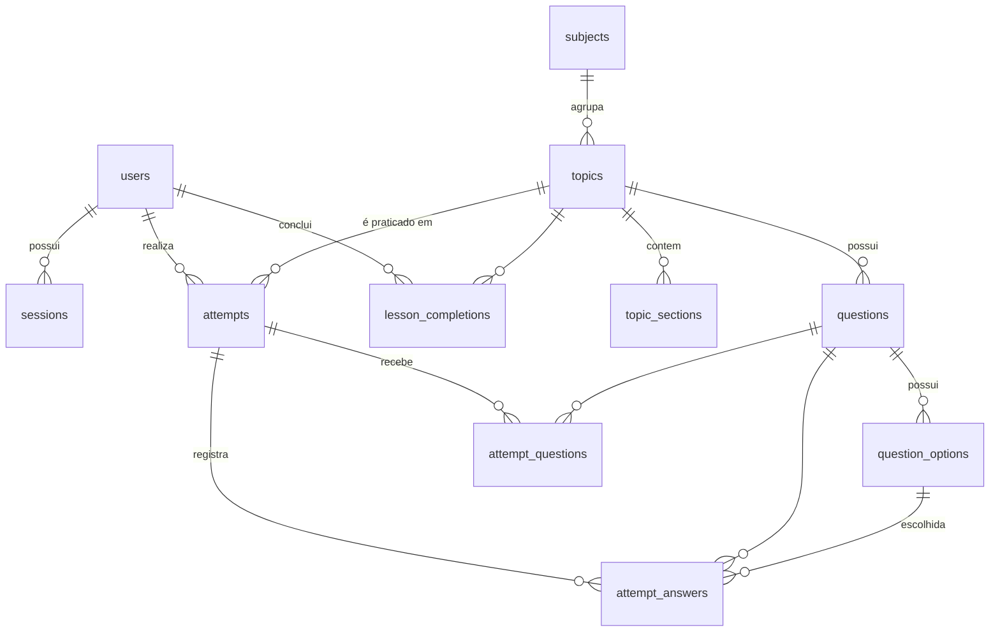

# Modelo de dados (MySQL)

Banco MySQL `simple_education` (nome configurável em `backend/.env`), criado automaticamente pelas migrations em `backend/src/db/migrations/`. Todas as tabelas usam InnoDB e `utf8mb4` (acentos preservados). Datas são gravadas em UTC.

Compatibilidade verificada: MySQL 8.0 e MariaDB 10.11. Requisito mínimo: MySQL 8.0.19+ ou MariaDB 10.2+ (a migration 003 usa `DROP CONSTRAINT`).

| Tabela | Finalidade | Campos principais |
|---|---|---|
| `users` | Usuários (estudantes ou não) | `id`, `name`, `email` (único), `password_hash` (scrypt + salt), `school_year` (1–3 ou NULL = não informado), `created_at`, `updated_at` |
| `sessions` | Sessões de login | `id_hash` (SHA-256 do token; o token puro fica só no cookie), `user_id`, `expires_at` |
| `subjects` | Matérias (hoje: Matemática) | `slug`, `name`, `description`, `position` |
| `topics` | Aulas | `subject_id`, `slug`, `school_year`, `title`, `summary`, `objective` (objetivo de aprendizagem), `position`, `search_text` (texto sem acentos para a pesquisa) |
| `topic_sections` | Conteúdo da aula | `topic_id`, `position`, `kind` (explicacao/formulas/exemplo/resumo), `title`, `body` |
| `questions` | Questões | `topic_id`, `code` (identificador estável, ex.: `funcoes-01`), `position`, `statement`, `explanation`, `difficulty` (facil/medio/dificil), `active` (0 = arquivada, mantida só para o histórico), `content_hash` |
| `question_options` | Alternativas A–D | `question_id`, `letter`, `text`, `is_correct` |
| `attempt_questions` | Questões entregues em cada tentativa | `attempt_id`, `question_id`, `position` |
| `attempts` | Tentativas de exercícios | `user_id`, `topic_id`, `started_at`, `finished_at`, `total_questions`, `correct_count` (calculado pelo servidor) |
| `attempt_answers` | Respostas | `attempt_id`, `question_id`, `option_id`, `is_correct`, `answered_at`; única por (tentativa, questão) |
| `lesson_completions` | Aulas concluídas | `user_id`, `topic_id`, `completed_at`; chave (usuário, assunto) |
| `schema_migrations` | Controle das migrations | `version`, `applied_at` |

Exclusões em cascata: apagar um usuário remove suas sessões, tentativas, respostas e aulas concluídas.

A distribuição dos assuntos por ano segue o projeto Simple Education e não representa uma organização curricular oficial.
